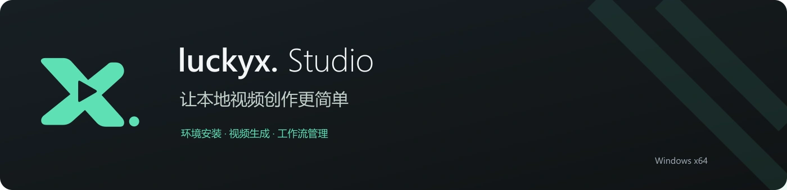
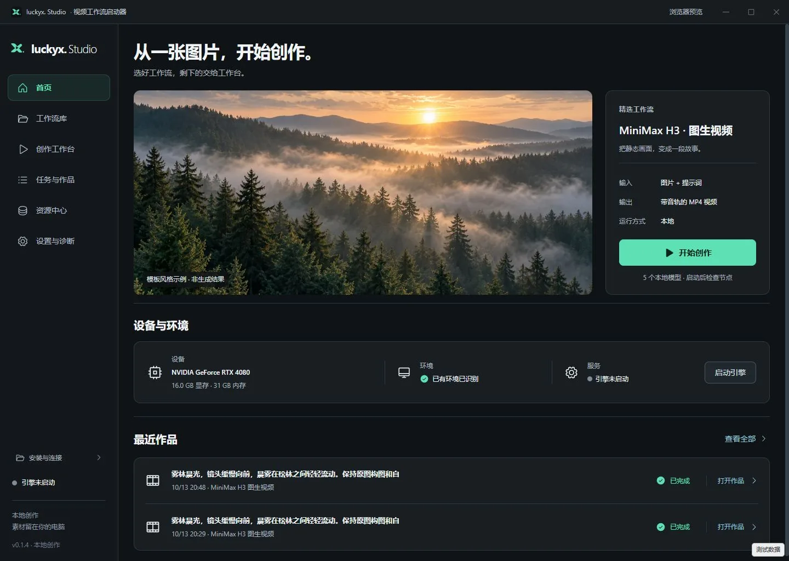
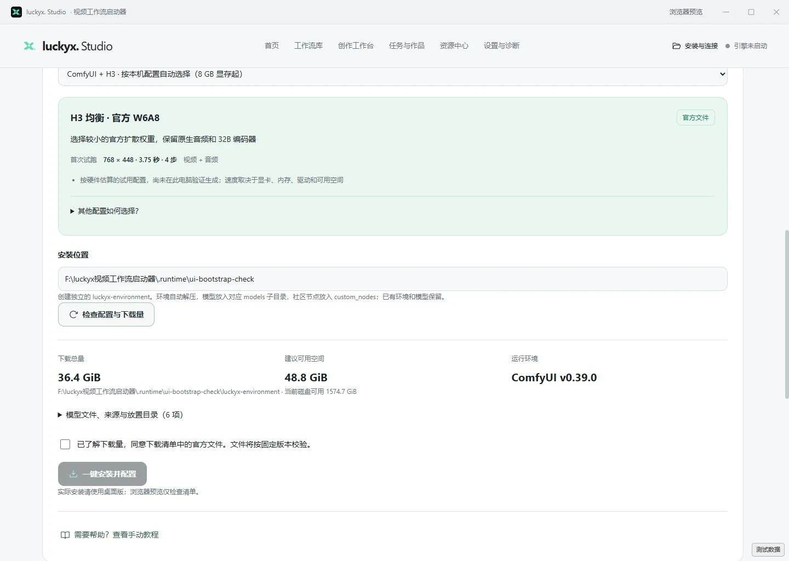
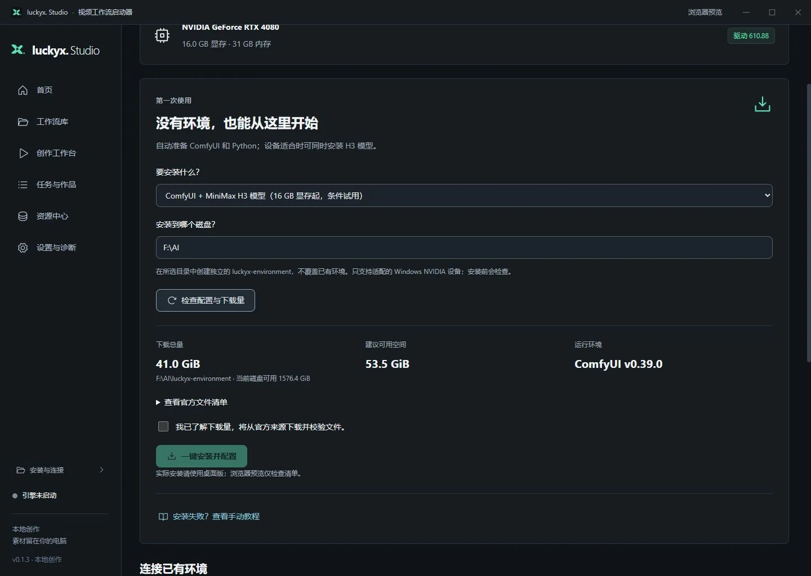
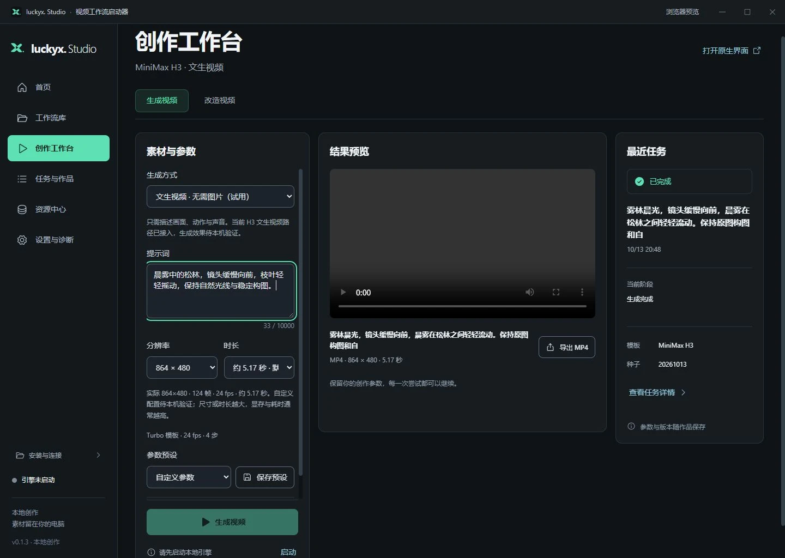
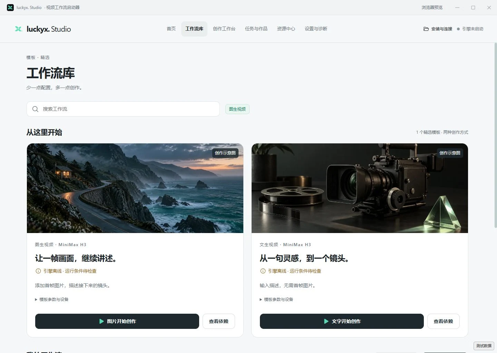
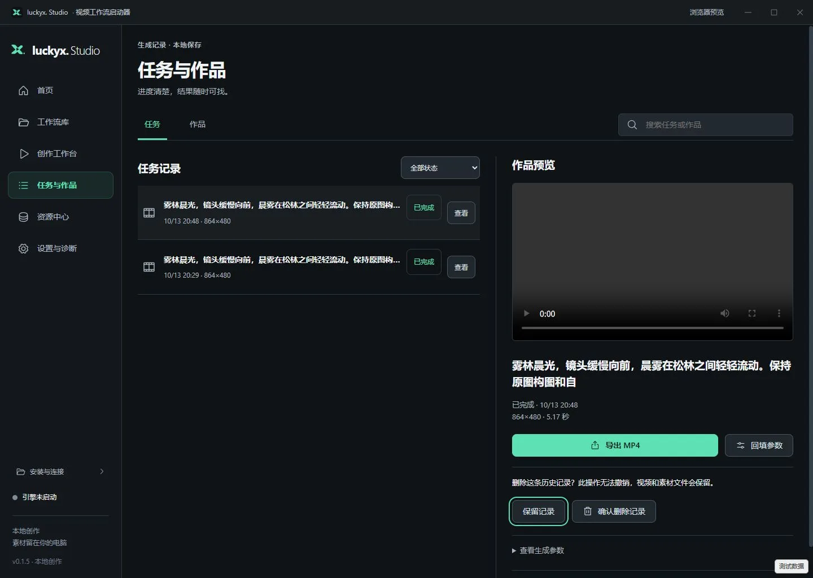
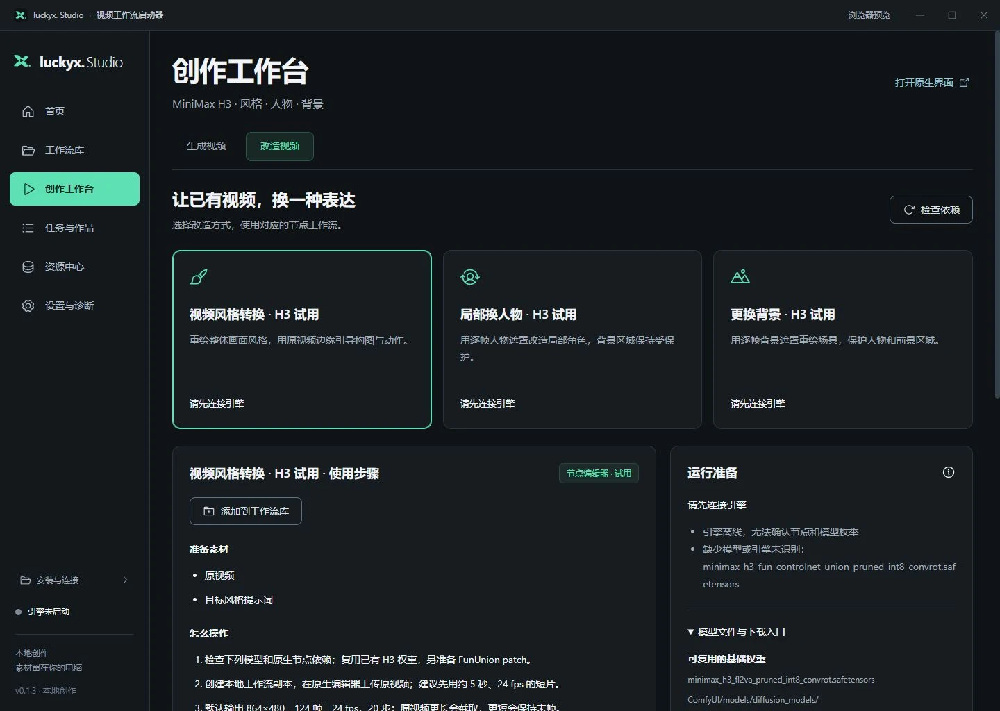
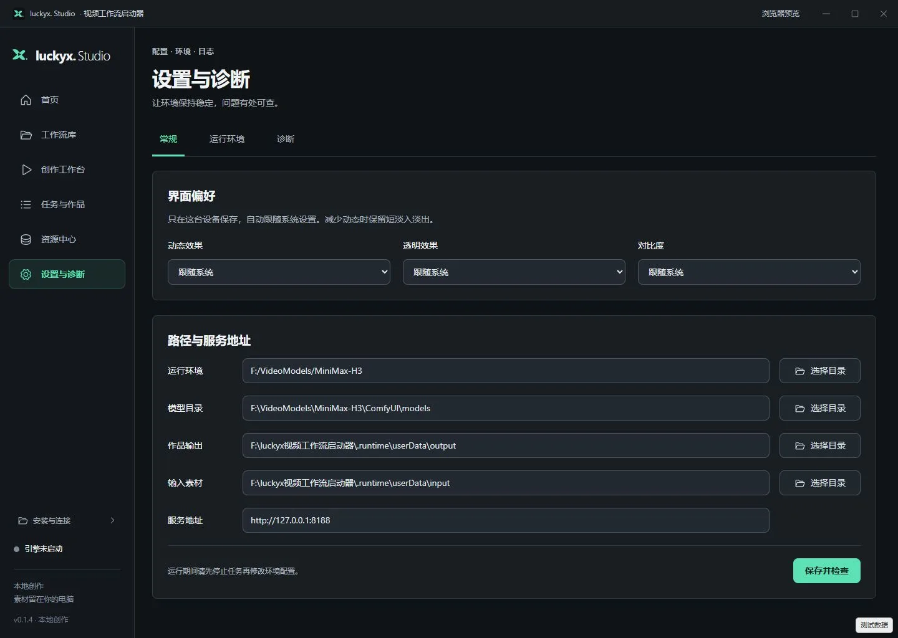
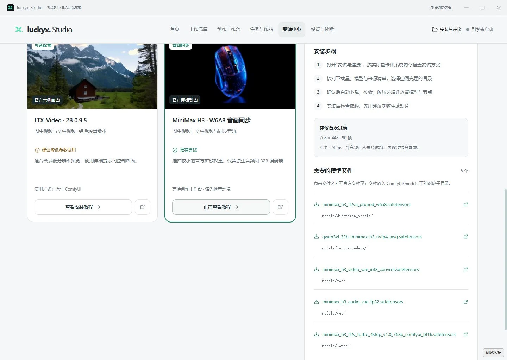

<p align="center"></p>

<p align="center"><strong>Windows 本地视频工作流启动器</strong><br />准备环境、管理工作流、生成视频，创作少一点配置。</p>

<p align="center">v0.1.10 · Windows x64 · Electron + Vue · 本地存储</p>

<p align="center"><a href="#快速开始">快速开始</a> · <a href="#使用教程">使用教程</a> · <a href="#更新与卸载">更新与卸载</a> · <a href="#从源码运行">开发与构建</a></p>

## 应用预览



截图来自 v0.1.6 本地浏览器预览，与桌面版共用正式界面。设备、路径和历史为本地演示环境；预览禁止实际安装及原生窗口操作。灵感图片标为风格示例，不是生成结果。

## 最新更新 · v0.1.10

- 优化打开应用的等待：先显示窗口，本地记录恢复后进入工作台。
- 恢复安装状态时不再查询下载源、读取整个压缩包或统计全部依赖文件。
- 引擎连接检查改为后台进行；继续安装仍执行完整文件与目录安全校验。
- 已有环境、下载缓存和任务记录保留，不自动启动引擎。

### v0.1.9 的主要改进

- 修复安装最后配置目录时遇到临时文件占用直接失败的问题，增加有限自动重试。
- 等待解压和 Python 检查进程关闭后再处理目录，减少 Windows 文件句柄占用。
- 目录占用或权限不足时显示中文处理方法，保留已下载模型和缓存，可继续配置。
- 重试仍检查目录安全性，不覆盖已有环境，不复制或清空整套模型。

### v0.1.8 的主要改进

- 下载前检查显卡、驱动与 CUDA 支持水平，避免文件全下载完才发现驱动不兼容。
- 按官方支持范围选择 RTX 的 CUDA 13 环境或旧显卡的 CUDA 12.6 基础环境。
- 模型下载前和安装结束时执行实际 GPU 小型运算检查，已有模型和下载缓存保留。
- 显示驱动、运行库、已缓存大小和官方驱动入口；文件齐全时显示“继续配置环境”。
- 重新检查和诊断会刷新硬件信息，已有可用环境不会被自动替换。

### v0.1.7 的主要改进

- 修复安装版首页、工作流库和视频改造图片缺失，品牌图标也统一使用本地资源路径。
- 下载使用 Windows 系统网络与代理；连接中断会自动重试，继续使用已保存的片段。
- 重试重新获取下载链接，避免临时链接过期；修正下载量重复累计。
- 安装失败说明改为中文，明确当前文件与总进度，不再重复显示同一错误。

### v0.1.6 的主要功能

- 银灰画廊进入正式应用，统一所有页面、留白、按钮和反馈。
- 从 8 GB 显存起，结合显卡、系统内存及磁盘空间自动选择 H3 文件。
- 自动下载校验、解压环境、放置模型和低配节点；重启保留安装位置与进度。
- 安装页识别已下载、待解压、已解压、模型待完成和环境就绪状态。
- 关闭窗口可选择继续后台或退出，支持记住选择和托盘重新打开。
- 重新设计安装、卸载向导；升级保留数据，卸载可选清理应用记录。

## 能做什么

| 功能 | 使用方式 |
| --- | --- |
| 环境准备 | 按本机配置安装 ComfyUI、Python 和 H3，或复用已有环境 |
| 视频生成 | 图片 + 提示词，或无需图片的文生视频；Lite 不含音频 |
| 尺寸与时长 | 横屏、竖屏、方形、自定义宽高和秒数，显示实际帧数 |
| 工作流管理 | 新建、导入、编辑、更新、导出和移除节点／API JSON |
| 原生节点编辑 | 复用 ComfyUI 编辑器，桌面版可保存编辑结果回库 |
| 视频改造 | 风格转换、局部换人物、换背景三份试用工作流 |
| 任务与作品 | 查看进度、取消、重试、删除已结束记录、预览及导出 MP4 |
| 资源与诊断 | 设备建议、模型来源、截图教程和缺失依赖检查 |
| 后台运行 | 收起到托盘，下载和任务继续；可记住关闭选择 |
| 界面偏好 | 减少动态、使用实色、提高对比度，默认跟随系统 |

## 快速开始

### 1. 安装启动器

当前安装包在本地 `dist/v0.1.10/`，尚未发布线上下载链接：

```text
luckyx-Studio-Setup-0.1.10-x64.exe
```

按新向导选择应用安装目录。升级前从托盘退出旧版，再覆盖安装，无需先卸载。安装包目前未签名。

源码仓库：[zxh111222/luckyx-Studio](https://github.com/zxh111222/luckyx-Studio)。仓库不包含安装包、模型权重和本地数据。

### 2. 没有 ComfyUI 或模型

打开顶部 **安装与连接**，选择“ComfyUI + H3 · 按本机配置自动选择”，填写磁盘目录，点击 **检查配置与下载量**。

| 方案 | 显存与系统内存参考 | 默认首次试跑 | 音频 |
| --- | --- | --- | --- |
| H3 Lite · 社区 W4A8 + 4B | 8 GB 显存起，约 16 GB 内存起，建议 32 GB | 608×352、约 2.33 秒、20 步 | 无 |
| H3 均衡 · 官方 W6A8 | 约 16 GB 显存起、32 GB 内存起 | 768×448、约 3.75 秒、4 步 | 有 |
| H3 标准 · 官方 INT8 | 约 24 GB 显存起、48 GB 内存起 | 864×480、约 5.17 秒、4 步 | 有 |
| 仅 ComfyUI | 先准备基础环境，再自行选择模型 | 不下载 H3 权重 | — |

高显存但系统内存较少时会选择更轻方案；磁盘空间不足时也会尝试较小方案，仍不足则阻止安装。下载总量、剩余空间和具体文件以检查页面为准。自动方案适用于已识别的 Windows NVIDIA RTX 20 系列及更新显卡；低于 8 GB、其他显卡或无法检测时提供手动教程。

8 GB 路线依据 [社区作者的 RTX 4060 Laptop／16 GB 内存实测](https://github.com/reventadirecta/MiniMax-H3-ComfyUI-8GB-VRAM)。它需要专用 4B 编码器、ClipProj 和 Spectrum 节点，输出仅视频；具体速度和效果需在自己的电脑试跑。[官方文件仓库](https://huggingface.co/Comfy-Org/MiniMax-H3/tree/main/diffusion_models)提供 W6A8 和 INT8 等版本。

核对文件来源与下载量并勾选确认，点击 **一键安装并配置**。



程序会：

1. 下载固定版本文件，校验大小和 SHA256。
2. 解压 ComfyUI Portable，自带 Python。
3. 将模型放入对应 `models` 子目录；Lite 节点解压到 `custom_nodes`。
4. 配置路径与启动参数，尝试启动并检查依赖。



安装目标为所选目录下的 `luckyx-environment`，已有环境不会被覆盖。暂停或退出后重新打开，可看到包已下载、待解压或模型待完成状态，确认后继续。下载中断时，保留原安装位置，检查网络或 Windows 系统代理后点击 **继续下载并安装**；保留 `.luckyx-bootstrap` 缓存以续用已下载片段。仍无法连接时展开手动教程。已安装的 INT8 环境可继续复用，不会自动替换权重。

### 3. 已有 ComfyUI

在同页下方 **连接已有环境** 填写运行环境、模型目录、素材／输出目录及本机服务地址（默认 `http://127.0.0.1:8188`），点击 **保存并检查**。Portable 可由启动器启动；手动环境可先自行启动再连接。更改模型目录后，ComfyUI 的搜索路径也需一致。

### 驱动和 CUDA 怎么选择

`nvidia-smi` 显示的 CUDA 版本是驱动支持水平，不是已安装的 CUDA Toolkit。便携环境自带运行库，无需另装 Toolkit。[NVIDIA 字段说明](https://docs.nvidia.com/deploy/nvidia-smi/index.html)

| 设备或状态 | 自动安装处理 |
| --- | --- |
| RTX 20 / 30 / 40 / 50、RTX A / PRO，驱动支持 CUDA 13 | 选择固定官方 CUDA 13 包，再按显存和内存推荐 H3 文件 |
| RTX 3070、驱动 546.30、CUDA 12.3 等较旧 RTX 驱动 | 下载前提示更新到 580 系列或更新驱动；保留已下载模型，更新后重新检查 |
| 支持的旧款 GTX 9 / 10、Quadro M / P | 可仅安装 CUDA 12.6 基础环境；较旧 CUDA 12 驱动标为条件试用，不自动安装 H3 |
| 驱动未知、显卡不在支持范围 | 提供检查提示、手动教程和连接已有环境 |
| 已有能正常运行的环境 | 继续复用，通过节点与模型检查判断能否运行，不自动改装运行库 |

本应用固定的 [ComfyUI v0.39.0 官方说明](https://github.com/Comfy-Org/ComfyUI/blob/v0.39.0/README.md)要求 RTX 使用 CUDA 13，CUDA 12.6 便携包面向旧显卡，不能仅凭显存把包互换。GPU 运算检查通过也不代表 H3 生成已经验证，首次仍用推荐短片参数试跑。

遇到截图中的“CUDA 13 检查未通过”时，打开 [NVIDIA 官方驱动页](https://www.nvidia.com/en-us/drivers/)更新驱动，按提示重启，再回到原安装位置点击 **检查配置与下载量 → 继续配置环境**。已有文件先校验再复用，无需重新下载完整模型。

### 下载完成但目录配置失败

若出现 `EPERM` / `EBUSY`，通常是文件占用或目录权限问题，不代表模型需要重下。新版会先等待检查进程关闭，并对临时占用自动重试。

仍未完成时，关闭正在使用所选目录的 ComfyUI、Python 和文件窗口，确认该目录可写，再回到**原安装位置 → 检查配置与下载量 → 继续配置环境**。保留 `.luckyx-bootstrap`；已有文件会重新校验和复用。目标目录已存在时，应用会停止并提示，不覆盖其中的文件。

## 使用教程

### 生成第一段视频

1. 启动或连接引擎，检查模型与节点。
2. 打开 **创作工作台 → 生成视频**，选择图生或文生模式。
3. 图生视频上传首帧；文生视频无需图片。
4. 填写画面、动作与镜头提示词；含音频方案可描述声音。
5. 点击 **使用环境建议参数**，再调整分辨率和时长。
6. 点击 **生成视频**，在任务页查看进度，完成后导出 MP4。



截图右侧为历史记录，不是当前提示词的生成结果。视频预览和导出需要可访问的输出文件。自定义秒数会换算为模型帧数，例如 10 秒实际约 10.13 秒；更大的尺寸与更长的视频通常占用更多显存。

### 新建、导入和编辑工作流

打开 **工作流库 → 我的工作流**，点击 **新建工作流** 或 **导入 JSON**。引擎就绪后，在桌面版打开节点编辑器，调整节点，再回到启动器 **保存编辑结果** 或 **导出 JSON**。



导入不会自动运行或下载依赖。自定义工作流在原生编辑器中运行，不套用精选模板表单。浏览器预览需导出 JSON 后拖入 ComfyUI，编辑后再更新 JSON。

### 查看作品与删除历史

在 **任务与作品** 选择记录，可预览、导出、回填参数。已完成、失败和中断的记录可点击 **删除历史记录 → 确认删除记录**；活动任务和状态待确认的任务不能删除。



只删除启动器记录，视频、素材与工作流文件保留；删除后刷新或重启不会重新显示。

### 改造已有视频

在 **创作工作台 → 改造视频** 选择风格转换、局部换人物或换背景，检查依赖并添加到工作流库，在原生编辑器上传原视频、提示词并运行。



局部改造另需与视频尺寸、帧率、时间对齐的逐帧黑白遮罩，白色区域重绘。三份流程需要额外 FunUnion 控制权重，一键 H3 安装不包含它；目前不自动生成遮罩。

### 关闭窗口与界面设置

桌面版关闭窗口时选择：

- **继续后台运行**：窗口收起到托盘，下载和任务继续；点击托盘图标重新打开。
- **退出并停止后台**：暂停下载，停止本应用启动的引擎；外部启动的 ComfyUI 保留。
- **记住我的选择**：下次按同样方式处理。可在 **设置与诊断 → 常规 → 关闭应用** 改回“每次询问”。

同页可设置减少动态、实色背景和增强对比度。默认跟随系统；Tab 切换控件，Escape 取消弹窗。



### 模型推荐与教程

打开 **资源中心 → 模型推荐与教程**，H3 清单随本机配置匹配，显示模型文件、目录、来源和截图教程。其他模型目前按教程在原生 ComfyUI 运行。



## 更新与卸载

升级复用原数据目录，保留设置、历史、参数预设和工作流。卸载默认保留数据，也可主动勾选清理本应用记录与缓存；视频、原图、模型、下载文件和 ComfyUI 环境保留。

桌面数据默认位于 `%APPDATA%\luckyx-studio\studio`。`dist/` 安装包、本地日志和 `docs/` 定稿图不提交 Git；公开教程图片随 README 保存在 `assets/readme/`。

## 当前使用范围

图生视频原有默认 INT8 配置已有本地出片记录。三档安装、续传恢复和关闭策略使用小资源／模拟进程验证，完整大模型安装、8 GB 实机出片和真实升级卸载仍需独立电脑验证。文生视频、自定义高参数及视频改造属于试用能力。

## 从源码运行

需要 Node.js **22.12 或更高版本**。

```bash
npm ci
npm run dev
```

检查与打包：

```bash
npm run check
npm test
npm run build
npm run dist
```

浏览器预览：`npm run preview`，打开 `http://127.0.0.1:4173/`。默认窗口 `1440×1024`，常规最小 `1200×720`，不超过屏幕工作区。环境包固定为 ComfyUI `v0.39.0`，解压器随安装包提供。

开发模式的数据压力测试仅用于界面验收，示例模式禁止真实安装、写入和生成，正式包不包含这些工具。

## 反馈与参考

反馈时附版本、显卡／显存、错误信息和复现步骤，避免上传私密素材和完整个人路径。

- [ComfyUI](https://github.com/Comfy-Org/ComfyUI) · [Windows Portable 指南](https://docs.comfy.org/installation/comfyui_portable_windows) · [H3 原生工作流](https://docs.comfy.org/tutorials/video/minimax/minimax-h3-native)
- [H3 低显存社区方案](https://github.com/reventadirecta/MiniMax-H3-ComfyUI-8GB-VRAM) · [ClipProj](https://github.com/nicolab28/ComfyUI-ClipProj) · [Spectrum](https://github.com/xmarre/ComfyUI-Spectrum-MiniMax-H3)
- README 信息组织参考 [DeskBox](https://github.com/Tianyu199509/DeskBox)。ComfyUI、模型和第三方组件遵循各自许可与使用条件。
